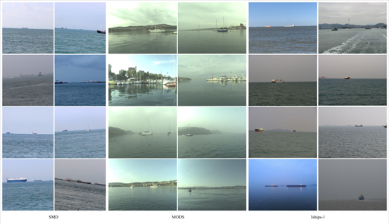
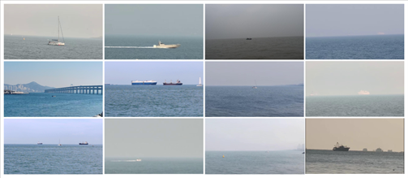
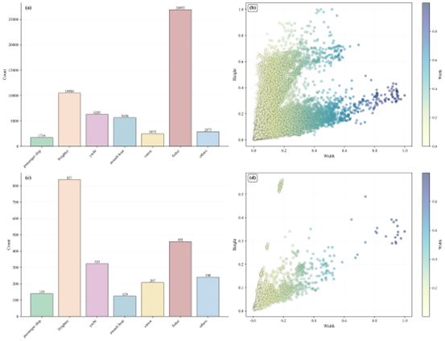

# USMD & UDLM: Maritime Small Object Datasets for USVs

## 1. Overview
This repository provides two maritime small-object datasets specifically designed from the **unmanned surface vessel (USV) perspective**, addressing the lack of **low-view, high-small-target-ratio** scenarios in existing maritime datasets.

- **USMD (The Small Maritime Datasets for USV)**： Large-scale training and evaluation benchmark datasets built from multiple public datasets
- **UDLM (The Small Maritime Datasets for USV collected in Dalian)**： Data were collected from real-world ocean areas for cross-domain generalization capability assessment.  

Both datasets use a unified 7-class annotation system and YOLO annotation standard to ensure **consistency and fairness of experimental results**.

---

## 2. Dataset Availability and Usage Notes

### 2.1 Current Public Release

The current public release includes **8,000 images from the USMD dataset**, along with their corresponding annotations in YOLO format. These images are provided **without predefined training, validation, or testing splits**, allowing researchers to establish their own data partitions according to different experimental requirements and evaluation protocols.

The publicly available dataset can be downloaded from **Baidu Netdisk**:

- **Download Link:** https://pan.baidu.com/s/1MYrwhMJyvDd6dt9re2VIbA

For researchers who are unable to access Baidu Netdisk, alternative download options are available upon request.

The complete USMD benchmark contains **14,350 images**, as described in our paper. Since USMD is constructed through the integration, screening, and relabeling of multiple publicly available datasets, we are currently releasing a curated subset while further reviewing the remaining data and associated redistribution conditions. Please note that the publicly released subset does not fully correspond to the experimental dataset used in the original paper.

### 2.2 UDLM Release Status

The UDLM dataset, comprising **1,042 images** collected in real-world nearshore environments using our self-developed USV platform, **is not yet publicly available**. We plan to release UDLM after completing the necessary data review and release preparations.


## 3. Dataset Description

### 3.1 USMD Dataset
- **Data source**: SMD, MODS and Iships-1 (Unified screening and relabeling)
- **Number of images**: 14,350
- **Number of instances**: 56,378
- **Data partitioning**: 7:2:1（train/val/test）
- **Resolution**: Multi-scale (training is uniformly 640×640)
- The USMD sample data is located in the directory: `/sample/USMD`
---

### 3.2 UDLM Dataset
- **Data source**: Data collected in the nearshore waters of Dalian using a self-developed USV platform. 
- **Number of images**: 1,042
- **Number of instances**: 2,328
- **Resolution**: 1920×1080
- The UDLM sample data is located in the directory: `/sample/UDLM`

---

### 3.3 Categories

| ID | 0 | 1 | 2 | 3 | 4 | 5 | 6 |
|----|----|----|----|----|----|----|----|
| Category | Passenger ship | Freighter | Yacht | Assault boat | Canoe | Fisher | Others 

---

## 4. Dataset Usage

### 4.1 Directory Structure

The dataset follows the standard YOLO format. The directory structure is organized as follows:

```
USMD/
├── images/
│   ├── train/
│   ├── val/
│   └── test/
├── labels/
│   ├── train/
│   ├── val/
│   └── test/
```
```
UDLM/
├── images/
├── labels/
```
---

### 4.2 Training Example

You can directly use the dataset with YOLO-based frameworks:

```bash
yolo detect train data=dataset.yaml model=yolov8n.yaml imgsz=640 batch=48 epochs=300
```

An example `dataset.yaml` file:

```yaml
path: dataset
train: images/train
val: images/val
test: images/test

nc: 7
names: [Passenger ship, Freighter, Yacht, Assault boat, Canoe, Fisher, Others]
```

### 4.3 Testing Example

You can evaluate a trained model using the following Python script:

```python
from ultralytics import YOLO

if __name__ == '__main__':

    # Load trained model
    model = YOLO('best.pt')

    # Run evaluation on the test set
    metrics = model.val(
        data='dataset.yaml',   # dataset configuration file
        split='test',          # evaluate on test set
        imgsz=640,             # image size
        batch=48,              # batch size
    )
```

**Notes:**

* Ensure that `best.pt` is the trained weight file
* `dataset.yaml` should correctly point to your dataset path

---

## 5. Dataset Statistics

### 5.1 USMD Statistics

| Class | Instances | Mean (%) | Median (%) | Q1 (%) | Q3 (%) | Max (%) |
|------|----------|----------|------------|--------|--------|--------|
| Passenger ship | 1734 | 0.58 | 0.08 | 0.03 | 0.34 | 14.30 |
| Freighter | 10486 | 1.60 | 0.61 | 0.15 | 1.71 | 36.28 |
| Yacht | 6285 | 1.59 | 0.49 | 0.12 | 1.85 | 45.26 |
| Assault boat | 5636 | 0.41 | 0.18 | 0.07 | 0.39 | 11.10 |
| Canoe | 2472 | 3.02 | 1.65 | 0.65 | 3.14 | 40.26 |
| Fisher | 26892 | 1.53 | 0.45 | 0.09 | 1.40 | 52.41 |
| Others | 2873 | 0.09 | 0.01 | 0.01 | 0.05 | 5.70 |
| **Total** | **56378** | **1.40** | **0.38** | **0.08** | **1.36** | **52.41** |

---

### 5.2 UDLM Statistics

| Class          | Instances | Mean (%) | Median (%) | Q1 (%) | Q3 (%) | Max (%) |
|----------------|-----------|----------|------------|--------|--------|---------|
| Passenger ship | 139       | 0.72     | 0.17       | 0.07   | 0.48   | 8.19    |
| Freighter      | 837       | 1.12     | 0.49       | 0.13   | 1.24   | 36.28   |
| Yacht          | 323       | 1.29     | 0.48       | 0.09   | 0.99   | 9.48    |
| Assault boat   | 124       | 0.21     | 0.14       | 0.12   | 0.22   | 1.12    |
| Canoe          | 207       | 5.61     | 2.70       | 1.71   | 4.92   | 36.73   |
| Fisher         | 458       | 2.13     | 0.47       | 0.22   | 2.16   | 13.31   |
| Others         | 240       | 0.11     | 0.07       | 0.03   | 0.14   | 1.24    |
| **Total**      | **2328**  | **1.57** | **0.40**   | **0.11** | **1.29** | **36.73** |

---

## 6. Visualization

### USMD Samples


### UDLM Samples


---

### Statistical Visualization



(a) USMD instance quantity distribution. (b) USMD aspect ratio distribution.  
(c) UDLM instance quantity distribution. (d) UDLM aspect ratio distribution. 

---

## 7. Contact

- **Ning Huang**: funny1201@foxmail.com
- **Affiliation**: Dalian Maritime University


## 8. Citation

If you use this dataset in your research, please cite our paper:

```bibtex
@article{YAO2026126533,
title = {DGP-SFNet: An efficient visual perception architecture for small maritime objects on unmanned surface vehicles},
journal = {Ocean Engineering},
volume = {363},
pages = {126533},
year = {2026},
issn = {0029-8018},
doi = {https://doi.org/10.1016/j.oceaneng.2026.126533},
url = {https://www.sciencedirect.com/science/article/pii/S002980182602367X},
author = {Jingyi Yao and Ning Huang and Wenjie Shi and Xinming Han and Changdong Yu}
}
